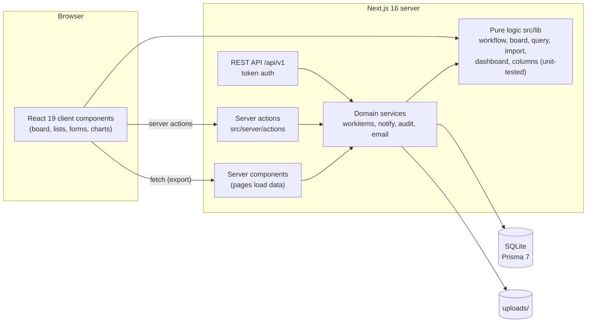
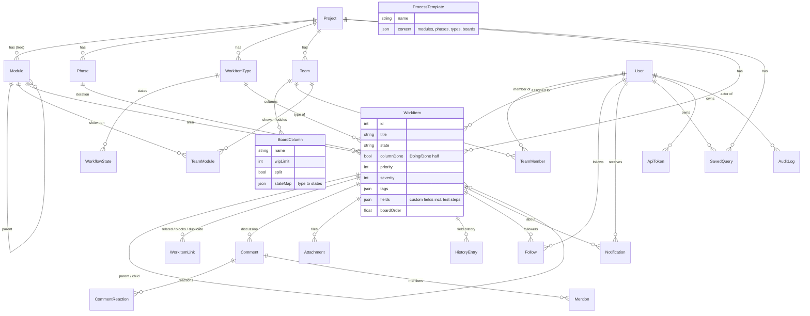

# TestBoard

Lightweight, self-hosted test tracking for SIT/UAT phases in HR system
implementations (for example SAP SuccessFactors), modelled on Azure Boards.
Boards, work items, test steps, defects, queries, dashboards, import/export and
a REST API – in English and Norwegian.

> **Norsk kortversjon:** TestBoard er et selvhostet verktøy for å følge opp
> testing (SIT/UAT) i HR-systemprosjekter, bygget etter modell av Azure Boards.
> Testoppgaver og feil vises på Kanban-tavler per team, med spørringer,
> dashbord, import fra Excel, eksport og REST API. Grensesnittet finnes på norsk
> og engelsk. Se [docs/glossary.md](docs/glossary.md) for begreper.

- [Quick start](#quick-start)
- [Features](#features)
- [Architecture](#architecture)
- [Data model](#data-model)
- [REST API](#rest-api)
- [Import and export](#import-and-export)
- [Configuration](#configuration)
- [Testing](#testing)
- [Known limitations](#known-limitations)
- [Next steps](#next-steps)
- [Glossary (concepts → Azure Boards)](docs/glossary.md)

## Quick start

Requires Node.js 22+.

```bash
npm install
npm run setup      # creates .env, migrates SQLite, generates the Prisma client, seeds demo data
npm run dev        # http://localhost:3000
```

Demo users (fictional) – password `demo1234` for all:

| User | Role |
| --- | --- |
| siri.holmvik@demo.test | Admin |
| erik.brattland@demo.test | Test Lead |
| nora.lindeberg@demo.test | Member (consultant) |
| jonas.fjellstad@demo.test | Member (consultant) |
| maja.sorli@demo.test | Member (business tester) |
| lars.myrvold@demo.test | Member (business tester) |

The seed creates one project (HRS) with 42 realistic work items, three team
boards, three phases (SIT 1, SIT 2, UAT), six modules, two shared queries, a
process template and some notifications.

### Production

```bash
npm run build
npm start          # set SESSION_SECRET (32+ chars) and APP_URL first
```

Back up `dev.db` (or the file in `DATABASE_URL`) and the `uploads/` folder.

## Features

**Work items** – test tasks (with steps, expected result, outcome, test data),
defects (severity, steps to reproduce, environment), questions, change
requests and tasks. Rich-text description, attachments and pasted screenshots,
parent/child and related/blocks/duplicate links, full field history,
discussion with @mentions (people and teams), #ID references and reactions.
"Create defect from failure" pre-fills a defect from a failed test.

**Boards** – one Kanban board per team, showing the work in the team's
modules. Configurable columns (state mapping per type, Doing/Done split, WIP
limits), swimlanes (by module, assignee, priority or custom rules), card fields
and colour rules. Drag and drop, keyboard move menu, quick add, virtualised
columns for large boards. Create new boards from the board page, optionally
copying another board's setup.

**Collaboration** – notification bell and Notifications page (assigned,
mentioned, state changed, commented), follow/unfollow, My work (assigned to me
by state, @mentioned, following), optional e-mail notifications with per-user
opt-out.

**Lists and queries** – work item list with filters, column chooser, flat or
tree view, inline editing, bulk edit (assign, state, priority, phase, module,
tags) and bulk create of test tasks (titles × modules × phases, from a
template). Saved queries (personal or shared) with AND/OR groups and sorting,
usable as a filter on boards and lists.

**Reporting** – dashboard per project, phase or board: open/critical defects,
pass rate, overdue; work by state and module, test results by module, defects
by severity/state/assignee, defect ageing, cumulative flow, burn-down per
phase, and for a board: items per column with WIP limits and flow by column.
Every chart has a table view.

**Import and export** – Excel/CSV import with column mapping (English and
Norwegian headers recognised), preview and row-level validation; Excel/CSV
export of any list or query.

**Administration** – users and roles, audit log, API tokens, process templates
(save a project's process, start new projects from it), keyboard shortcuts
(`?` lists them).

### Roles

| Role | Can |
| --- | --- |
| Admin | Everything, including users, audit log, all API tokens, deleting templates |
| Test Lead | Configure projects, boards, types and workflows; shared queries; import; bulk create; delete work items |
| Member | Create and edit work items, comment, personal queries |
| Read-only | View everything, follow items, personal queries; no changes |

### Keyboard shortcuts

`?` help · `n` new work item · `/` filter · `e` edit title · `a` assign to me ·
`Ctrl/⌘+Enter` save · `Esc` close panel.

## Architecture



- **Next.js App Router** (`src/app`). Pages are server components that load
  data and render client components. `cacheComponents` is off on purpose: every
  page is per-user and request-time. `src/proxy.ts` (the Next 16 middleware)
  only redirects users without a session cookie; real checks happen on the
  server.
- **Mutations** go through server actions (`src/server/actions/*`) that return
  `{ ok, data | error }`. All work item writes use one service
  (`src/server/workitems.ts`) that validates the workflow, records field-level
  history and triggers notifications – the UI, bulk operations, import and the
  REST API share it.
- **Pure logic** lives in `src/lib` (workflow rules, board column mapping,
  query evaluation, swimlanes, import validation, dashboard metrics, export
  columns) and runs both in the browser and on the server. It has no I/O and is
  covered by unit tests.
- **Auth**: e-mail/password (bcrypt), session as a signed JWT cookie (jose).
  API tokens are random 256-bit values stored as SHA-256 hashes.
- **i18n**: flat dictionaries in `src/lib/i18n.ts`; English is the source,
  Norwegian (bokmål) overrides.

```
src/
  app/            routes: (app) pages, login, api/ (export, import template, v1, docs)
  components/     client components by area (board, item, list, query, dashboard, import, ...)
  lib/            pure, shared logic (unit-tested)
  server/         server-only services, actions, REST helpers
  generated/      Prisma client (generated)
prisma/           schema, migrations, seed
tests/unit        Vitest
tests/e2e         Playwright smoke tests
scripts/          setup and performance seed
docs/             glossary
```

## Data model



Notes:
- Custom fields are defined per type (`WorkItemType.fields`) and stored as JSON
  on the item (`WorkItem.fields`), including test steps.
- `HistoryEntry` holds one row per changed field; `rev` groups a save. The
  cumulative flow and burn-down charts are replayed from it.
- Team swimlanes and card settings are JSON on `Team`.

## REST API

Create a token from the user menu → **API tokens** and send it as
`Authorization: Bearer tb_…`. A token acts as its owner with the owner's role.

- Readable reference: **`/api/docs`**
- OpenAPI 3.1 spec: **`/api/v1/openapi.json`**

| Method | Path | Purpose |
| --- | --- | --- |
| GET | `/api/v1/me` | The token's user |
| GET | `/api/v1/projects` | Projects |
| GET | `/api/v1/projects/{id or key}/meta` | Types, states, fields, modules, phases, users |
| GET | `/api/v1/projects/{id or key}/workitems` | List with filters (type, state, assignedTo, module, phase, changedSince, q, limit, offset) |
| POST | `/api/v1/projects/{id or key}/workitems` | Create |
| GET / PATCH / DELETE | `/api/v1/workitems/{id}` | Read, update (workflow rules apply), delete (Admin/Test Lead) |
| GET / POST | `/api/v1/workitems/{id}/comments` | Comments |

Values use names, not ids: type keys (`DEFECT`), state names, user e-mails,
module paths (`Employee Central > Hire`) and phase names.

```bash
curl -H "Authorization: Bearer $TB_TOKEN" -H "Content-Type: application/json" \
  -d '{"type":"DEFECT","title":"Probation end date wrong","module":"Hire","phase":"SIT 2","severity":2}' \
  http://localhost:3000/api/v1/projects/HRS/workitems
```

## Import and export

**Import** (Test Lead/Admin): project menu → **Import**. Upload `.xlsx` or
`.csv` (comma, semicolon or tab; UTF-8). Columns are matched automatically from
English or Norwegian headers (Tittel, Status, Tildelt, Modul, Fase, Frist,
Teststeg, …) and can be changed. Every row is validated before anything is
written; you can skip rows with errors. Users are matched by e-mail or full
name, modules by path or unique name, dates as `yyyy-mm-dd`, `dd.mm.yyyy` or
Excel dates. Test steps go in one cell, one step per line:
`1. Open Add New Employee | Form opens`. **Download Excel template** gives the
headers, an example row and a sheet of valid values.

**Export**: any list or query → **Export** → Excel or CSV, with the columns and
rows shown. CSV is UTF-8 with BOM and uses `;` as separator in Norwegian
(Norwegian Excel default) and `,` in English. Cells starting with `=`, `+`,
`-` or `@` are prefixed with `'` so spreadsheets never run them as formulas.

## Configuration

`.env` (created from `.env.example` by `npm run setup`):

| Variable | Meaning |
| --- | --- |
| `DATABASE_URL` | SQLite file, default `file:./dev.db` |
| `SESSION_SECRET` | 32+ random characters; signs session cookies |
| `UPLOAD_DIR` | Attachment folder, default `uploads` |
| `APP_URL` | Base URL used in e-mails and API links |
| `EMAIL_NOTIFICATIONS_ENABLED` | `true` to send e-mails |
| `EMAIL_TRANSPORT` | `console` (log, default) or `file` (write `.eml` files) |
| `EMAIL_OUTBOX_DIR` | Folder for the `file` transport, default `outbox` |
| `EMAIL_FROM` | Sender address |

A real mail service (SMTP, SendGrid, Microsoft Graph) is added as a new
transport in `src/server/email.ts`.

## Testing

| Script | Purpose |
| --- | --- |
| `npm test` | Unit tests (Vitest): workflow, board mapping, swimlanes, queries, mentions, import, export columns, tree, dashboard and board metrics, e-mail content |
| `npm run test:e2e` | Playwright smoke tests (board, collaboration, lists/queries/dashboard, import, API, templates, shortcuts). Needs `npx playwright install chromium`, or set `PW_CHROMIUM_PATH` to an existing Chromium. Reuses a dev server on `E2E_PORT` (default 3100). |
| `npm run typecheck` / `npm run lint` | Static checks |
| `npm run db:seed` | Reset demo data |
| `npm run db:perf-seed` | Add 600 extra work items for load testing (`npm run db:seed` to reset) |

**Performance** (production build, 680 work items, one board with ~620 of
them): board ≈ 380 ms to first cards (columns are virtualised), work item list
≈ 270 ms, tree view ≈ 290 ms (tables are virtualised), dashboard and board
report ≈ 400–560 ms, keyword filter on the board ≈ 100 ms after the 150 ms
debounce.

**Accessibility**: keyboard alternatives for drag and drop, focus rings,
labelled controls, skip link, live regions for moves and saves, table views for
every chart, colour never the only signal (icons and labels on test results and
WIP warnings), text contrast ≥ 4.5:1 (WCAG AA). Checked with an automated DOM
check (labels, names, duplicate ids, headings) on all main pages and manual
keyboard testing; not yet audited with a screen reader or axe-core.

## Known limitations

- **SQLite, single server.** Fine for a project team (tens of users, thousands
  of items). Many concurrent writers or several app servers need PostgreSQL
  (Prisma supports it with a provider change and new migrations).
- **Everything is loaded per page.** Boards, lists and the dashboard load all
  items of the project/board and filter in the browser. Comfortable up to a few
  thousand items per project; beyond that, filtering should move to the
  database.
- **Notifications** are polled every 60 seconds (no WebSockets). E-mail
  delivery only has console and file transports out of the box.
- **Reports replay history** with each item's *current* phase, type and board
  configuration; they do not reconstruct past module/phase moves or column
  changes.
- **Board column mapping** can map several states to one column; dropping a
  card uses the first state. The Doing/Done flag is stored on the item, so it is
  shared by all boards showing it.
- **No per-project permissions.** Roles are global; every user sees every
  project.
- **REST API**: no rate limiting, no webhooks, no attachment upload; comments
  are plain text (no @mentions).
- **Import** creates new items only (no update/merge by external id) and
  cannot create modules, phases or users on the fly.
- **Templates** copy swimlane/card rules that reference specific users as-is;
  such rules must be adjusted after creating a project.
- **Accessibility** has had automated and keyboard checks, not a full
  screen-reader audit.

## Next steps

1. PostgreSQL option and server-side filtering/pagination for very large
   projects.
2. Per-project membership and permissions; SSO (Microsoft Entra ID) login.
3. Real e-mail transport (SMTP/Graph) and a daily digest; Teams/Slack webhooks.
4. Test plans and test runs (several runs of the same test case per phase, with
   per-step results), like Azure Test Plans.
5. Import updates by external id (round-trip with Excel), and SuccessFactors
   test case catalogues as templates.
6. Webhooks and rate limiting for the REST API.
7. Screen-reader audit (NVDA/VoiceOver) and axe-core in the e2e suite.
